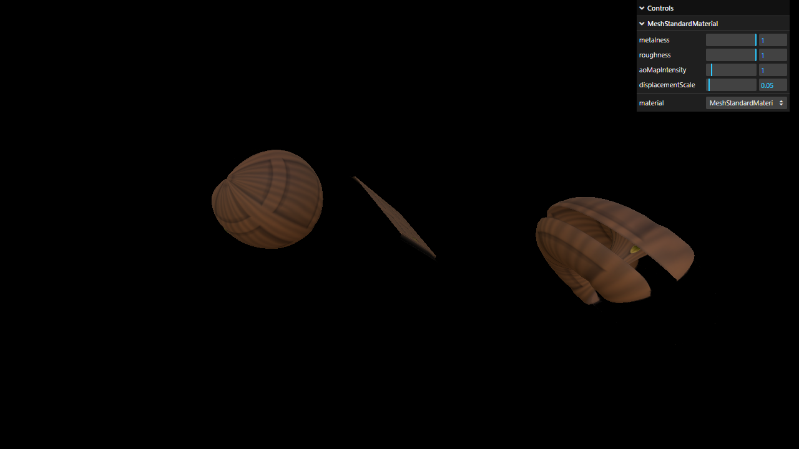

# Activity 1.10 - Materials

**Student:** Nimrod P. Pala, ITE 18-FNHX1
**Course:** ITE-18 Applications Development and Emerging Technologies, Caraga State University
**Instructor:** James Earl D. Cubillas
**Reference:** Bruno Simon, *Three.js Journey*, "Introduction to Three.js" handouts (Part 10)



## What was done

- Sphere, plane and torus share one material and rotate in `tick()`.
- `AmbientLight` + `PointLight`.
- **Material dropdown (lil-gui):** every material from the handout is built in its own labeled block and can be switched live: Basic, Normal, Matcap, Depth, Lambert, Phong, Toon (with `gradientMap` + `NearestFilter`), Standard, and Standard with envMap only.
- Default / final state: `MeshStandardMaterial` with `map`, `aoMap`, `displacementMap` (`displacementScale` 0.05, higher segment counts), `metalnessMap`, `roughnessMap`, `normalMap` + `normalScale`, `alphaMap` + `transparent`.
- lil-gui sliders for `metalness`, `roughness`, `aoMapIntensity` and `displacementScale`.
- Environment map loaded with `CubeTextureLoader` (px, nx, py, ny, pz, nz) and used as `envMap`.

## How to run

```bash
npm install
npm run dev
```

Then open the URL Vite prints (usually <http://localhost:5173>).
`npm run build` creates a production build in `dist/`.

## Deviations from the handout (current three.js r186)

- Addons (OrbitControls, etc.) are imported from `three/addons/...` instead of `three/examples/jsm/...`.
- `lil-gui` instead of `dat.gui`.
- The `uv2` attribute is **not** needed for `aoMap` anymore. Since r151, `aoMap` reads the normal `uv` attribute, so the `setAttribute('uv2', ...)` lines are left commented out with an explanation.
- Lights use physical units now (r155+), so `PointLight` intensity is **30** instead of 0.5 (and ambient is 1), otherwise the scene is almost black.
- `THREE.Clock` is deprecated in r186. `THREE.Timer` (`timer.update()` + `timer.getElapsed()`) is used instead.
- Color textures (door color, matcap, env map) are set to `SRGBColorSpace`.

Each deviation is also commented in `src/script.js`.

## Assets

- **Generated:** `textures/door/*.jpg` and `textures/gradients/3.jpg`, `5.jpg` (same filenames as the course).
- **Downloaded:** `textures/matcaps/1-8.png` from [nidorx/matcaps](https://github.com/nidorx/matcaps) (see `SOURCES.txt`).
- **Downloaded:** `textures/environmentMaps/0/*.jpg`: "Park2" cube map by Emil Persson (Humus) from the three.js repository `examples/textures/cube/` (see `readme.txt`).

## Files

```
src/index.html   canvas.webgl + loads style.css and script.js
src/style.css
src/script.js    the Three.js code
static/          textures / fonts (served from /)
vite.config.js   root: src, publicDir: ../static, outDir: ../dist
```
