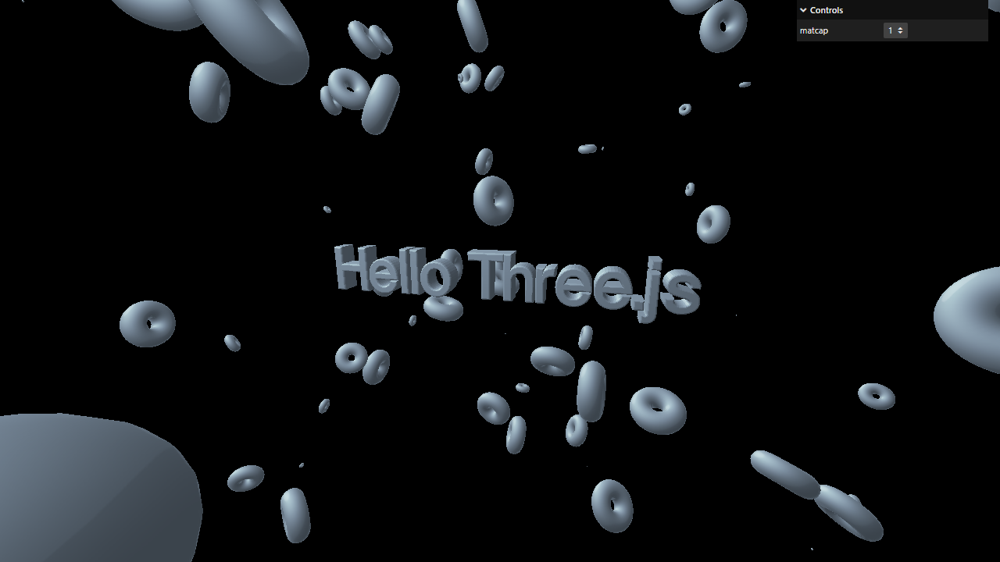

# Activity 1.11 - 3D Text

**Student:** Nimrod P. Pala
**Section:** ITE 18-FNHX1
**Instructor:** James Earl D. Cubillas



## What it does

- The text "Hello Three.js" in 3D, in the middle of the screen.
- 100 donuts floating around it.
- A menu in the top-right corner changes the look of the text and donuts (matcap).

## How to run

```bash
npm install
npm run dev
```

Then open the link it prints in your browser.
