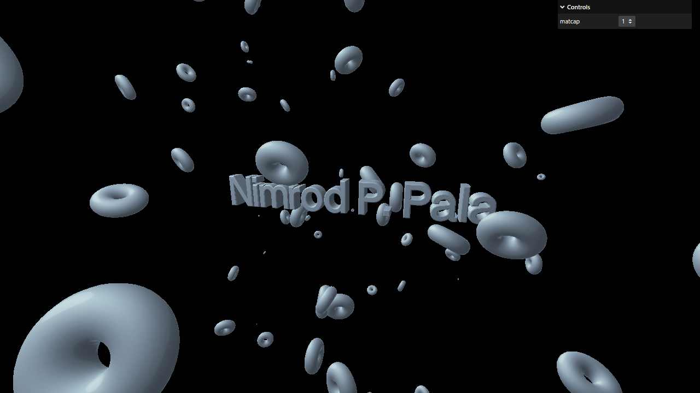

# Activity 1.12 - Go Live

**Student:** Nimrod P. Pala, ITE 18-FNHX1
**Course:** ITE-18 Applications Development and Emerging Technologies, Caraga State University
**Instructor:** James Earl D. Cubillas
**Reference:** Bruno Simon, *Three.js Journey*, "Introduction to Three.js" handouts (Part 12)



## What was done

- Based on the finished Activity 1.11 project (3D text + 100 donuts), personalized: the text reads **'Nimrod P. Pala'** with a smaller centered line **'ITE 18-FNHX1'** under it, and the page title is "Nimrod P. Pala | ITE-18 Three.js".
- `vercel` installed with `npm install vercel`.
- `"deploy": "vercel --prod"` added to the `package.json` scripts.
- Deployment steps (output directory = `dist`) are in **[DEPLOYMENT.md](DEPLOYMENT.md)**.
- **Live URL:** <https://pala-nimrod-threejs-go-live.vercel.app>

## How to run

```bash
npm install
npm run dev
```

Then open the URL Vite prints (usually <http://localhost:5173>).
`npm run build` creates a production build in `dist/`.

To deploy: `npm run deploy` (see [DEPLOYMENT.md](DEPLOYMENT.md)).

## Deviations from the handout (current three.js r186)

- Addons (OrbitControls, etc.) are imported from `three/addons/...` instead of `three/examples/jsm/...`.
- Same deviations as Activity 1.11 (`depth` instead of `height`, sRGB matcaps).

Each deviation is also commented in `src/script.js`.

## Assets

- **Downloaded:** `fonts/helvetiker_regular.typeface.json` + `LICENSE` from the three.js repository `examples/fonts/` (the npm package no longer includes this folder).
- **Downloaded:** `textures/matcaps/1-8.png` from [nidorx/matcaps](https://github.com/nidorx/matcaps) (see `SOURCES.txt`).

## Files

```
src/index.html   canvas.webgl + loads style.css and script.js
src/style.css
src/script.js    the Three.js code
static/          textures / fonts (served from /)
vite.config.js   root: src, publicDir: ../static, outDir: ../dist
```
