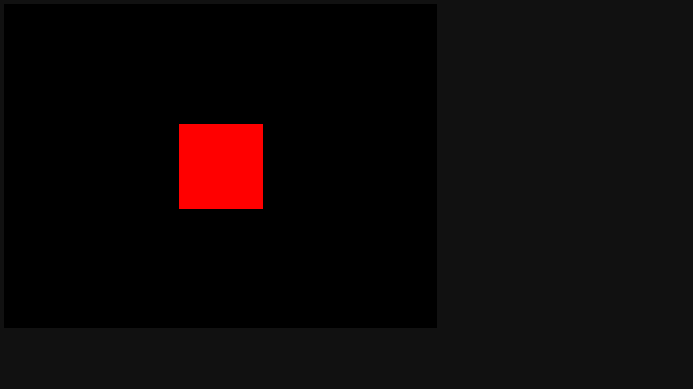

# Activity 1.5 - Cameras

**Student:** Nimrod P. Pala, ITE 18-FNHX1
**Course:** ITE-18 Applications Development and Emerging Technologies, Caraga State University
**Instructor:** James Earl D. Cubillas
**Reference:** Bruno Simon, *Three.js Journey*, "Introduction to Three.js" handouts (Part 5)



## What was done

- Red cube (`BoxGeometry` + `MeshBasicMaterial`) in an 800x600 canvas.
- `PerspectiveCamera` (fov 75, near 0.1, far 100).
- `OrbitControls` with `enableDamping = true`, updated every frame in `tick()`.
- Earlier handout steps kept as commented code: `OrthographicCamera` with aspect ratio, and moving the camera by hand with the cursor.
- This project is the starter for Activity 1.6.

## How to run

```bash
npm install
npm run dev
```

Then open the URL Vite prints (usually <http://localhost:5173>).
`npm run build` creates a production build in `dist/`.

## Deviations from the handout (current three.js r186)

- Addons (OrbitControls, etc.) are imported from `three/addons/...` instead of `three/examples/jsm/...`.

Each deviation is also commented in `src/script.js`.

## Files

```
src/index.html   canvas.webgl + loads style.css and script.js
src/style.css
src/script.js    the Three.js code
vite.config.js   root: src, publicDir: ../static, outDir: ../dist
```
