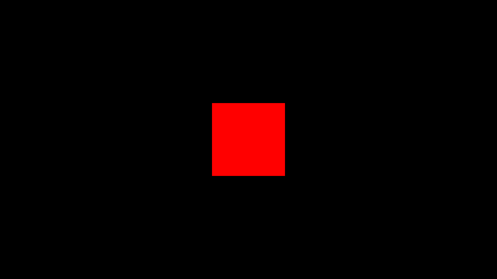

# Activity 1.6 - Fullscreen and Resizing

**Student:** Nimrod P. Pala, ITE 18-FNHX1
**Course:** ITE-18 Applications Development and Emerging Technologies, Caraga State University
**Instructor:** James Earl D. Cubillas
**Reference:** Bruno Simon, *Three.js Journey*, "Introduction to Three.js" handouts (Part 6)



## What was done

- Canvas fills the window (`sizes` from `window.innerWidth` / `innerHeight`).
- CSS reset: `*` margin/padding 0, `.webgl` fixed at top-left with no outline, `html, body` overflow hidden.
- `resize` listener updates `sizes`, `camera.aspect`, `camera.updateProjectionMatrix()`, `renderer.setSize()` and `renderer.setPixelRatio(Math.min(window.devicePixelRatio, 2))`.
- Double-click toggles fullscreen, with the `webkit`-prefixed fallbacks for Safari.

## How to run

```bash
npm install
npm run dev
```

Then open the URL Vite prints (usually <http://localhost:5173>).
`npm run build` creates a production build in `dist/`.

## Deviations from the handout (current three.js r186)

- Addons (OrbitControls, etc.) are imported from `three/addons/...` instead of `three/examples/jsm/...`.

Each deviation is also commented in `src/script.js`.

## Files

```
src/index.html   canvas.webgl + loads style.css and script.js
src/style.css
src/script.js    the Three.js code
vite.config.js   root: src, publicDir: ../static, outDir: ../dist
```
