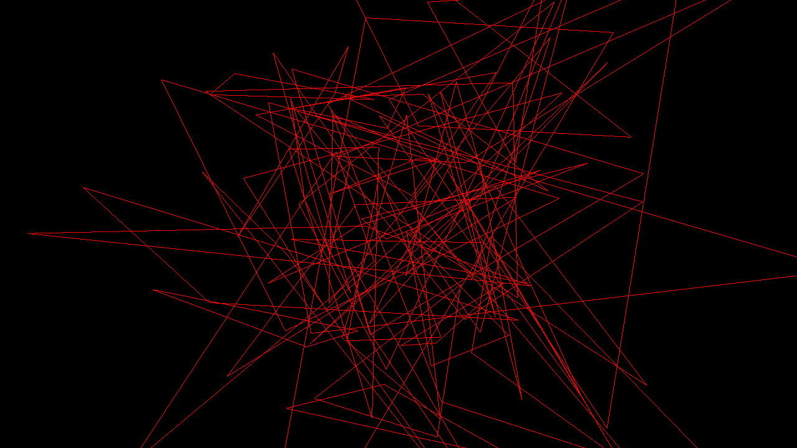

# Activity 1.7 - Geometries

**Student:** Nimrod P. Pala, ITE 18-FNHX1
**Course:** ITE-18 Applications Development and Emerging Technologies, Caraga State University
**Instructor:** James Earl D. Cubillas
**Reference:** Bruno Simon, *Three.js Journey*, "Introduction to Three.js" handouts (Part 7)



## What was done

- Step 1 (commented out): `BoxGeometry(1, 1, 1, 2, 2, 2)` in wireframe, to see the subdivisions.
- Step 2 (commented out): `SphereGeometry(1, 32, 32)` in wireframe.
- Step 3 (commented out): a single triangle from a `Float32Array`.
- Step 4 (active): custom `BufferGeometry` with **50 random triangles**: `Float32Array(count * 3 * 3)`, `BufferAttribute(positionsArray, 3)` set as the `position` attribute, red wireframe material.

## How to run

```bash
npm install
npm run dev
```

Then open the URL Vite prints (usually <http://localhost:5173>).
`npm run build` creates a production build in `dist/`.

## Deviations from the handout (current three.js r186)

- Addons (OrbitControls, etc.) are imported from `three/addons/...` instead of `three/examples/jsm/...`.

Each deviation is also commented in `src/script.js`.

## Files

```
src/index.html   canvas.webgl + loads style.css and script.js
src/style.css
src/script.js    the Three.js code
vite.config.js   root: src, publicDir: ../static, outDir: ../dist
```
