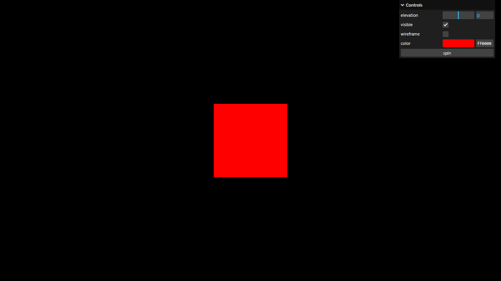

# Activity 1.8 - Debug UI

**Student:** Nimrod P. Pala, ITE 18-FNHX1
**Course:** ITE-18 Applications Development and Emerging Technologies, Caraga State University
**Instructor:** James Earl D. Cubillas
**Reference:** Bruno Simon, *Three.js Journey*, "Introduction to Three.js" handouts (Part 8)



## What was done

- Debug panel with **lil-gui**:
  - `mesh.position.y` slider (min -3, max 3, step 0.01, named `elevation`)
  - `mesh.visible` checkbox
  - `material.wireframe` checkbox
  - `addColor(parameters, 'color')` with `onChange` calling `material.color.set(...)`
  - a `spin` button that rotates the cube one full turn with **gsap**

## How to run

```bash
npm install
npm run dev
```

Then open the URL Vite prints (usually <http://localhost:5173>).
`npm run build` creates a production build in `dist/`.

## Deviations from the handout (current three.js r186)

- Addons (OrbitControls, etc.) are imported from `three/addons/...` instead of `three/examples/jsm/...`.
- Uses `lil-gui` (`import { GUI } from 'lil-gui'`) instead of `dat.gui`. lil-gui is the maintained drop-in replacement with the same API.

Each deviation is also commented in `src/script.js`.

## Files

```
src/index.html   canvas.webgl + loads style.css and script.js
src/style.css
src/script.js    the Three.js code
vite.config.js   root: src, publicDir: ../static, outDir: ../dist
```
