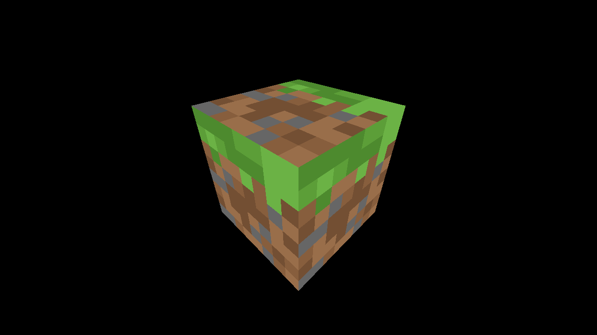

# Activity 1.9 - Textures

**Student:** Nimrod P. Pala, ITE 18-FNHX1
**Course:** ITE-18 Applications Development and Emerging Technologies, Caraga State University
**Instructor:** James Earl D. Cubillas
**Reference:** Bruno Simon, *Three.js Journey*, "Introduction to Three.js" handouts (Part 9)



## What was done

- `LoadingManager` that logs `onStart`, `onLoad`, `onProgress` and `onError` (open the browser console to see it).
- `TextureLoader` loads all seven door textures: color, alpha, height, normal, ambientOcclusion, metalness, roughness.
- Labeled commented-out steps for: loading with the native `Image` API, `repeat` + `RepeatWrapping` / `MirroredRepeatWrapping`, `offset`, `rotation` with `center` 0.5, and `minFilter` / `magFilter` with the two checkerboards.
- Final step (active): `minecraft.png` with `magFilter = NearestFilter`, `minFilter = NearestFilter` and `generateMipmaps = false`.

## How to run

```bash
npm install
npm run dev
```

Then open the URL Vite prints (usually <http://localhost:5173>).
`npm run build` creates a production build in `dist/`.

## Deviations from the handout (current three.js r186)

- Addons (OrbitControls, etc.) are imported from `three/addons/...` instead of `three/examples/jsm/...`.
- Color textures get `texture.colorSpace = THREE.SRGBColorSpace` (required since three.js r152, otherwise colors look washed out).

Each deviation is also commented in `src/script.js`.

## Assets

- **Generated** with a Node script (pngjs + jpeg-js), using the same filenames as the course: `textures/door/*.jpg` (color, alpha, height, normal, ambientOcclusion, metalness, roughness), `checkerboard-1024x1024.png`, `checkerboard-8x8.png`, `minecraft.png`.

## Files

```
src/index.html   canvas.webgl + loads style.css and script.js
src/style.css
src/script.js    the Three.js code
static/          textures / fonts (served from /)
vite.config.js   root: src, publicDir: ../static, outDir: ../dist
```
