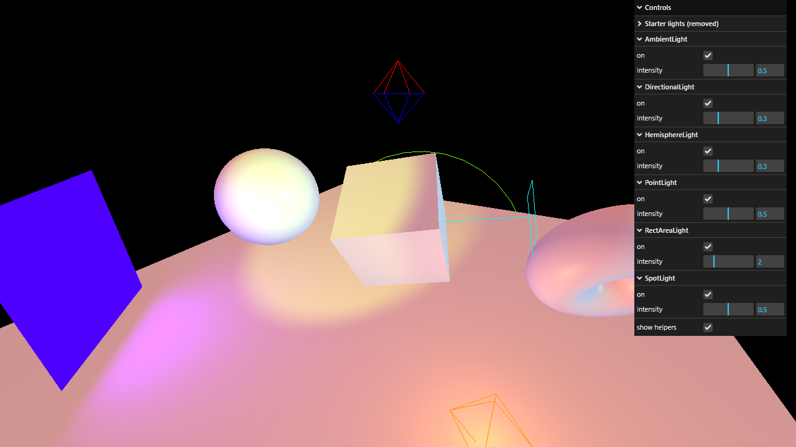

# Activity 2.1 - Lights

**Student:** Nimrod P. Pala
**Section:** ITE 18-FNHX1
**Instructor:** James Earl D. Cubillas



## What it does

- A sphere, a cube and a donut slowly rotating above a floor.
- All six light types from the handout are on at once: ambient, directional, hemisphere, point, rect area and spot.
- A menu in the top-right corner turns each light on or off and changes its intensity.
- The wireframe shapes are the light helpers, which show where each light is; one checkbox hides them all.

## How to run

```bash
npm install
npm run dev
```

Then open the link it prints in your browser.
