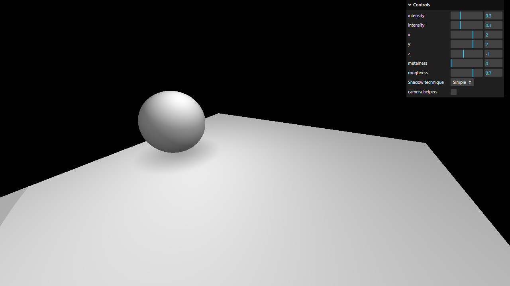

# Activity 2.2 - Shadows

**Student:** Nimrod P. Pala
**Section:** ITE 18-FNHX1
**Instructor:** James Earl D. Cubillas



## What it does

- A sphere bounces in a circle over a floor, with a soft fake shadow under it that fades as the sphere goes up.
- The "Shadow technique" menu switches between the three ways of making shadows from the handout: Real-time, Baked and Simple.
- Real-time uses three lights that cast shadows (directional, spot and point); the "camera helpers" box shows what each light sees.
- The other sliders change the light intensities, the directional light's position and the material.

## How to run

```bash
npm install
npm run dev
```

Then open the link it prints in your browser.
