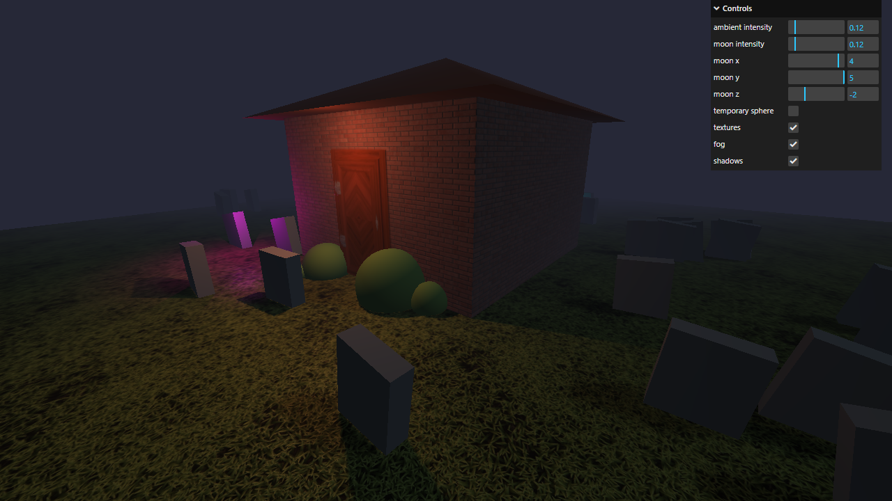

# Activity 2.3 - Haunted House

**Student:** Nimrod P. Pala
**Section:** ITE 18-FNHX1
**Instructor:** James Earl D. Cubillas



## What it does

- A small brick house with a roof, a textured door and four bushes, surrounded by 50 randomly placed graves on a grass floor.
- Fog, dim blue moonlight and a warm light above the door make the night scene.
- Three colored lights (the "ghosts") float around the house and pass through the walls and the ground.
- The menu in the top-right corner changes the lights and can switch the textures, fog and shadows off to show the earlier steps.

## How to run

```bash
npm install
npm run dev
```

Then open the link it prints in your browser.
