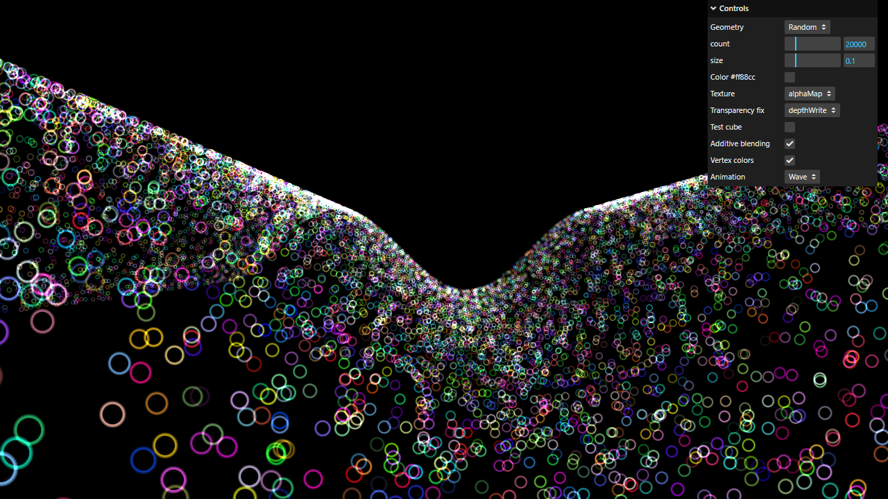

# Activity 3.1 - Particles

**Student:** Nimrod P. Pala
**Section:** ITE 18-FNHX1
**Instructor:** James Earl D. Cubillas



Step-by-step screenshots (numbered in the order of the handout) are in [screenshots/](screenshots/), and a short screen recording is in [recording.mp4](recording.mp4).

## What it does

- 20000 particles are placed at random positions, each with its own random color.
- Every particle uses a small circle texture as an alpha map, and additive blending makes the colors glow where they overlap.
- The particles move up and down on a wave that travels across the scene.
- The menu in the top-right corner can switch back to the earlier steps: the sphere of particles, the single pink color, the map before the alpha map, the alphaTest and depthTest fixes (with the test cube), and the rotation before the wave.

## How to run

```bash
npm install
npm run dev
```

Then open the link it prints in your browser.
