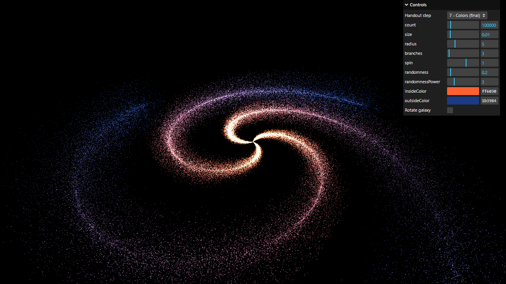

# Activity 3.2 - Galaxy Generator

**Student:** Nimrod P. Pala
**Section:** ITE 18-FNHX1
**Instructor:** James Earl D. Cubillas



Step-by-step screenshots (numbered in the order of the handout) are in [screenshots/](screenshots/), and a short screen recording is in [recording.mp4](recording.mp4).

## What it does

- A spiral galaxy of 100000 particles with three branches, orange in the middle and blue on the edges.
- The particles are spread more on the outside than near the center, and they twist more the further they are from the center.
- Changing any value in the menu (count, size, radius, branches, spin, randomness, colors) builds a new galaxy and removes the old one.
- The "Handout step" menu shows each version of the shape from the handout, and "Rotate galaxy" turns the whole galaxy slowly, as in the instructor's video.

## How to run

```bash
npm install
npm run dev
```

Then open the link it prints in your browser.
