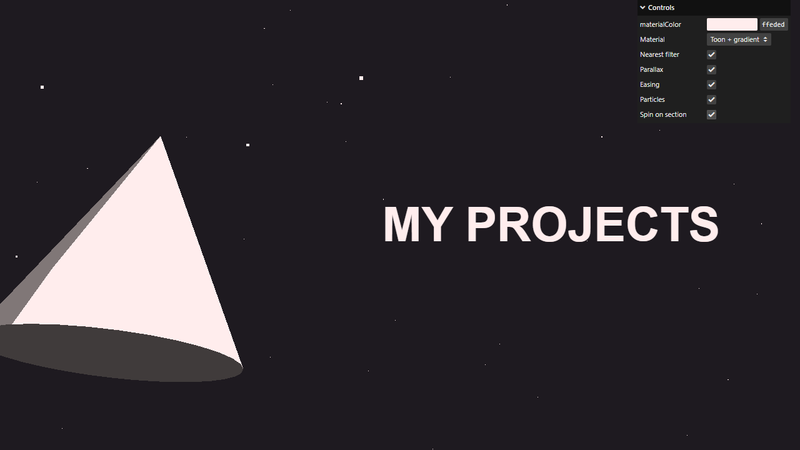

# Activity 3.3 - Scroll Based Animation

**Student:** Nimrod P. Pala
**Section:** ITE 18-FNHX1
**Instructor:** James Earl D. Cubillas



Step-by-step screenshots (numbered in the order of the handout, taken at different scroll positions) are in [screenshots/](screenshots/), and a short screen recording is in [recording.mp4](recording.mp4).

## What it does

- A simple one-page portfolio ("My Portfolio", "My projects", "Contact me") with a Three.js scene behind the text.
- Each section has its own toon-shaded object (a torus, a cone and a torus knot), and the camera follows the page as you scroll.
- The camera also moves a little with the mouse (parallax with easing), and small stars fill the background of all three sections.
- When you reach a section, its object does a quick spin (made with GSAP). The menu can switch back to the earlier steps of the handout.

## How to run

```bash
npm install
npm run dev
```

Then open the link it prints in your browser.
