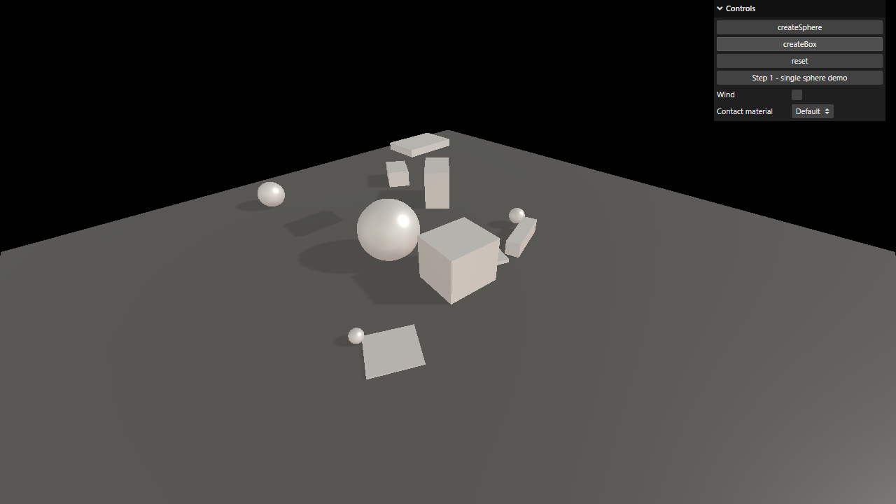

# Activity 3.4 - Physics

**Student:** Nimrod P. Pala
**Section:** ITE 18-FNHX1
**Instructor:** James Earl D. Cubillas



Step-by-step screenshots (numbered in the order of the handout) are in [screenshots/](screenshots/), and a short screen recording is in [recording.mp4](recording.mp4).

## What it does

- A physics world made with Cannon.js (the cannon-es version) runs next to the Three.js scene, and every mesh copies the position and rotation of its physics body on each frame.
- On load, one box falls onto the floor. The createSphere and createBox buttons drop spheres and boxes of random sizes that bounce, roll and tumble; reset removes them all.
- Strong hits play a sound at a random volume (click the page once first, because Chrome blocks sounds until you do).
- The menu in the top-right corner can also replay the first step of the handout: a single sphere pushed to the right, with an optional wind and a choice between the concrete/plastic materials and the default material.

## How to run

```bash
npm install
npm run dev
```

Then open the link it prints in your browser.
