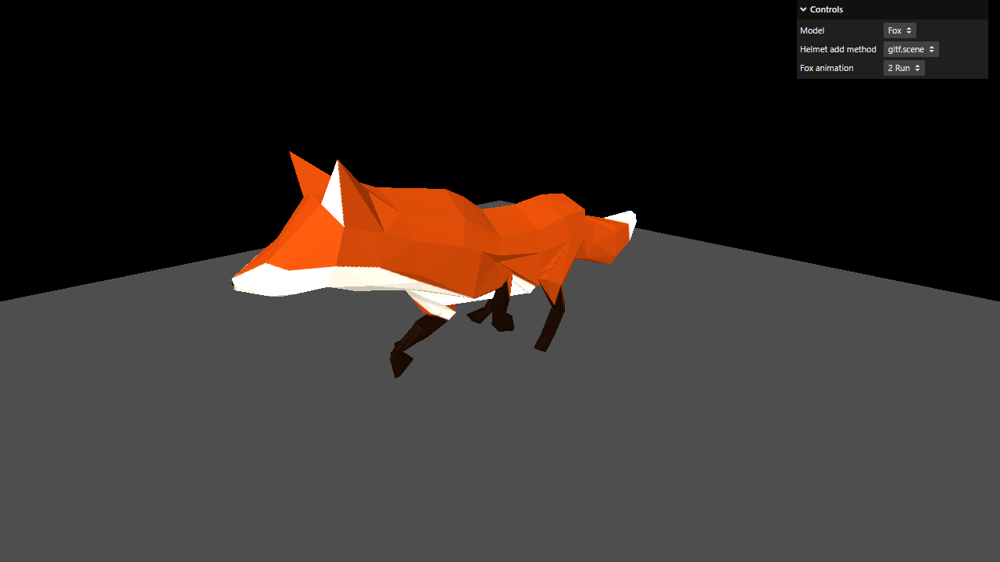

# Activity 3.5 - Imported Models

**Student:** Nimrod P. Pala
**Section:** ITE 18-FNHX1
**Instructor:** James Earl D. Cubillas



Step-by-step screenshots (numbered in the order of the handout) are in [screenshots/](screenshots/), and a short screen recording is in [recording.mp4](recording.mp4).

## What it does

- Loads 3D models made in other software, in the glTF format, with Three.js's GLTFLoader.
- On load, a low-poly fox runs on a grey floor, animated with an AnimationMixer.
- The Model menu switches to the duck in its four formats (glTF, Binary, Embedded and the Draco-compressed one, which needs the DRACOLoader) and to the Flight Helmet.
- The other menus show the five ways the handout tries to add the helmet's parts to the scene (including the buggy loop that misses some of them) and the fox's three animations (survey, walk and run).

I also tried the Three.js editor (<https://threejs.org/editor/>) by hand, as in the last part of the handout: dropping the glTF-Binary duck in shows it black until an AmbientLight and a DirectionalLight are added. That part has no code.

## How to run

```bash
npm install
npm run dev
```

Then open the link it prints in your browser.
